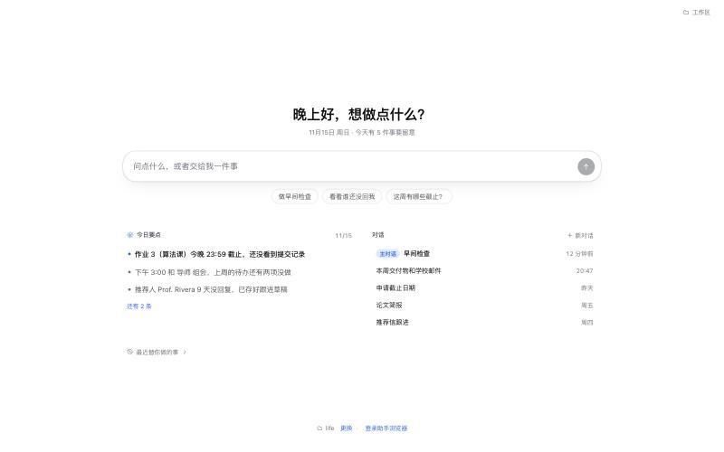

# DSH Personal Agent

A personal assistant plugin for DeepSeek Harness (DSH) on macOS. It adds a **Personal** agent preset that works with your Apple Calendar, Reminders, Notes and Mail, keeps a 今日 (today) sticky note and a weekly work journal, and makes DSH open on your main conversation.

[中文说明](README.zh-CN.md) · [Security](SECURITY.md)

| 今日 note over the main conversation | Overview page |
|---|---|
|  |  |

<sub>Screenshots use made-up sample data.</sub>

> **Status:** early, macOS only. The persona and the interface are in Chinese for now (an English version is on the roadmap); the tools themselves work in any language.

## What it does

- **Apple apps through a small helper app.**
  - Read your calendar and reminders. New events and reminders are created only after you confirm a card in DSH.
  - Add to-dos to one "assistant" list in Reminders, and mark reminders done (never deletes).
  - Search, read and create notes in one assistant folder.
  - Read mail that Apple Mail has synced, and save drafts and reply drafts. It **never sends** mail.
- **今日 sticky note.**
  - A small note pinned over the main conversation with today's top items and quick questions.
  - Drag it to either side; it snaps to the nearer edge and remembers where you put it.
  - Click the note to fold it into a small pill, and click the pill to open it again.
  - It steps aside while the left sidebar is open, and comes back when you collapse it.
  - The assistant crosses items off and adds new ones as the day goes (`today_update`).
- **Tasks with one consistent state.**
  - Each task gets a stable id and keeps where it came from (an email's Message-ID), the next step, who it waits on and when it counts as done. The same email never makes a second task.
  - Ownership is split: Reminders owns a linked reminder's done state and due time, Calendar owns events, the plugin's `tasks.json` keeps only links and context, and the 今日 note is a view.
  - `task_list` checks Reminders and Mail first, so a reminder ticked off or a reply sent directly in those apps shows up. It tells "draft saved" apart from "reply sent", and when a check fails it says so instead of reporting everything done.
- **Rescheduling and repeats.**
  - Move reminders and events (`reminders_update`, `calendar_update`), including "remind me tomorrow" or "push it a week" as relative moves that keep the time of day across daylight-saving changes. A moved reminder no longer rings at its old time.
  - Daily, weekly, monthly or yearly repeats with an end date or a count; for a repeating event you choose "only this one" or "this and later ones".
  - Every change shows the old and new values on a confirmation card, with overlapping events and free slots that day. The same request sent twice does not create a second event or reminder.
- **Weekly journal.**
  - One Markdown file per week (`journal/2026/2026-W46.md`) with a section per day.
  - A 本周总结 (week summary) is added on top once the week is over, plus a monthly summary. Quarterly and yearly summaries are written when you ask.
  - Day entries are never deleted.
- **Personalities.**
  - Six built-in speaking styles: 助理 (assistant, default), 专业 (professional), 高效 (efficient), 搭档 (friendly partner), 直率 (candid) and 傲娇 (an elegant, cool, sharp-tongued tsundere, for fun: it sighs at you, fixes everything flawlessly, then says "don't get the wrong idea"; it drops the act only for real distress, health or bad news).
  - Three tweaks: warmth, lists and emoji.
  - Set a default in your workspace's `AGENTS.md`, or switch mid-conversation.
- **Research helpers.**
  - `arxiv_search`.
  - `bib_add`, which appends a paper to your BibTeX/JabRef library.
  - A read-only Research subagent (`ask_research`) that the main agent delegates paper searches to.
- **Action log.** Every event, reminder, to-do, draft, note, BibTeX entry, completed reminder and note change is appended to a plain-text log you can read back.
- **A home that DSH opens on.**
  - A launch splash, then your main conversation with the left sidebar collapsed.
  - An 助理 (overview) page with today's points, recent conversations and recent actions.

It also uses DSH's own tools: files, web search, bash in the DSH sandbox, schedules, Office files, skills and memory (with the Mnemon plugin). It can optionally drive a headless Chrome through Microsoft's Playwright MCP, with a visible window only when you need to sign in.

## Requirements

- macOS 14 or later.
- DeepSeek Harness desktop `0.2.2-rc.3` or a later `0.2.x`.
- To build from source: Node.js 20+ and the Xcode command line tools (`xcode-select --install`) for the Swift helper.

## Install

### From source (for now)

```bash
git clone https://github.com/alexz949/dsh-personal-agent.git
cd dsh-personal-agent
npm run build
npm test
```

Then link the folder into your DSH desktop profile and restart DSH (⌘Q, then open it again):

```bash
"/Applications/DeepSeek Harness.app/Contents/Resources/runtime/cli/bin/dsh" plugin --profile desktop add link:$PWD
```

With a link, updating is `git pull && npm run build`, then restart DSH. `dsh plugin` forwards its arguments to pnpm in the profile folder.

### From npm

Not published yet. Once it is: `dsh plugin --profile desktop add dsh-personal-agent`.

## First run

1. **Set up a workspace.** Copy [`template/`](template) somewhere private and fill in `shared/USER_PROFILE.md` and the "This user's setup" section of `agents/life/AGENTS.md` (mail accounts, folders, default personality). Your notes, journal and profile must never go into a public repository.
2. **Add it to DSH.** Add `agents/life` as a DSH workspace and start a conversation with the **Personal** preset. The home asks which workspace to use the first time.
3. **Allow permissions.** The first Calendar, Reminders, Notes or Mail request opens **Personal Agent Helper**, and macOS asks for permission. Allow it.
   - macOS ties the permission to the helper's code signature. Rebuilding the helper after changing `helper/` may ask again.
4. **Optional: Reminders list.** Create a list named `Assistant` in Reminders for `todo_add`, or set another name (see Settings).

## Settings

Optional, in `~/.dsh/personal-agent/config.json`. You can override the path with `PERSONAL_AGENT_CONFIG`.

```json
{
  "todoList": "Assistant",
  "notesFolder": "Assistant",
  "bibLibrary": "~/Documents/JabRef/library.bib",
  "actionLog": "~/.dsh/personal-agent/actions.md",
  "browserProfile": "~/.dsh/mcp/playwright/profile",
  "tasksFile": "~/.dsh/personal-agent/tasks.json"
}
```

`bib_add` is offered only when `bibLibrary` is set.

### Browser automation (optional)

The preset starts Playwright MCP from `~/.dsh/mcp/playwright`, using `/usr/local/bin/node`:

```bash
mkdir -p ~/.dsh/mcp/playwright && cd ~/.dsh/mcp/playwright && npm install @playwright/mcp
```

On Apple Silicon with Homebrew, Node is usually `/opt/homebrew/bin/node`. Change `command` in the `mcp-browser` row of `cordis.patch.yml`. If it is not installed, the other tools keep working.

The browser runs **headless**, so no window opens while the assistant works. It uses its own Chrome profile in `~/.dsh/mcp/playwright/profile` and never sees your everyday Chrome logins.

When a site needs you to sign in (for example a two-step school login), the assistant closes the background browser and calls `browser_login`. That opens the same profile in a visible Google Chrome window. Sign in, quit that window with ⌘Q, and the background browser reuses the saved login from then on. You can also start this from **登录助手浏览器** at the bottom of the overview page. The profile path can be changed with `browserProfile` in the settings file.

To read pages the assistant links to without leaving DSH, set DSH's chat link preference to open links in the in-app sidebar. DSH's own sidebar browser is for you only: the model cannot see or control it.

## Tools

| Tool | What it does | Asks first? |
|---|---|---|
| `calendar_events`, `reminders_list`, `notes_search`, `notes_read`, `mail_accounts`, `mail_list`, `mail_read` | read | no |
| `calendar_create`, `reminders_create` | create an event / reminder (optionally repeating; shows conflicts) | **yes** (DSH card) |
| `reminders_update`, `calendar_update` | change or move a reminder / event | **yes** (old and new values) |
| `task_create`, `task_update`, `task_list` | record and track tasks linked to reminders and emails | no |
| `todo_add` | add a to-do to the assistant list | no |
| `reminders_complete` | mark a reminder done | no for the assistant list, **yes** for others |
| `mail_draft`, `mail_reply_draft` | save a draft in Mail (never sends) | no |
| `notes_create` | new note in the assistant folder | no |
| `today_update` | change the 今日 note (`today.md`) | no |
| `journal_status`, `journal_write` | read / write the weekly journal | no |
| `bib_add` | append a paper to your BibTeX file | no |
| `arxiv_search` | search arXiv | no |
| `notify` | macOS notification banner | no |
| `browser_login` | open the assistant browser's profile in a visible Chrome window for signing in | no |
| `browser_save_output` | copy a browser screenshot into the workspace's `files/` so it shows inline in the chat | no |

## Claude Code (optional)

`mcp/server.js` is a stdio MCP server that gives Claude Code the same Apple, notification, arXiv and BibTeX tools. Confirmation cards become MCP elicitations, or the host's permission prompt with `--confirm=permission`.

## How it plugs into DSH

- `cordis.patch.yml` adds the `personal` and `personal-research` agent presets and the client bundle.
- Host tools are ordinary DSH tool modules: `lib/apple.js`, `today.js`, `journal.js` and others.
- The client (`lib/client.js`) uses DSH's public client services where they exist: layout, workspaces, sessions, workspace files, right-sidebar tabs and the `shell.overlay` slot.
- A few internal pieces are used with fallbacks when they are missing:
  - Collapsing the left sidebar on older builds.
  - Sending a question straight into a conversation (`sessions.binding(...).session.prompt`).
  - Filling a conversation's draft.

  A future DSH release may change them.

## Development

```bash
npm run build   # writes lib/ and, on macOS, rebuilds the helper only when helper/ changed
npm test        # node --test; uses no network and none of your settings
```

## License

[MIT](LICENSE)
