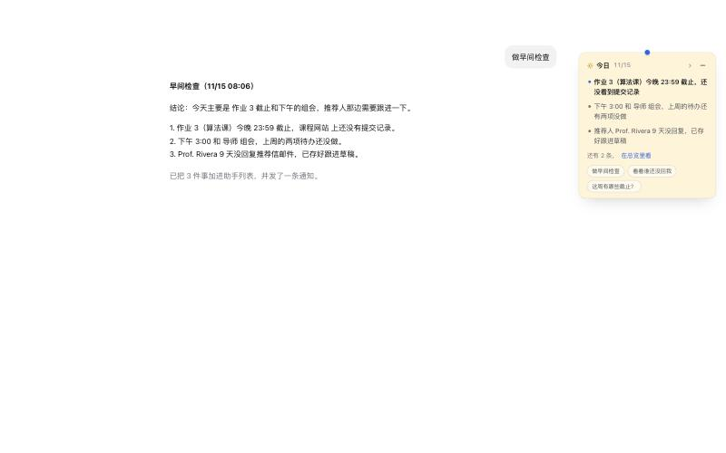
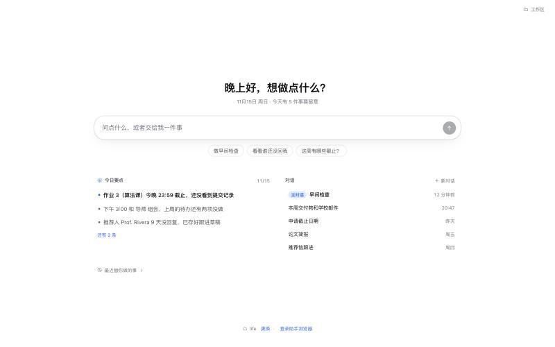

# DSH Personal Agent（个人助理插件）

给 macOS 上的 DeepSeek Harness（DSH）用的个人助理插件。它加了一个 **Personal** 助手预设：能用 Apple 日历、提醒事项、备忘录和邮件，维护一张“今日”便签和一份按周记的工作日记，并让 DSH 一打开就进入你的主对话。

[English](README.md) · [安全说明](SECURITY.md)

| 主对话上的“今日”便签 | 总览页 |
|---|---|
|  |  |

<sub>截图使用虚构的示例数据。</sub>

> **状态：** 早期版本，仅支持 macOS。人设和界面目前是中文。

## 功能

- **Apple 应用，通过一个小的辅助 App 访问**
  - 日历和提醒：可以查看；新建前会在 DSH 里弹确认卡片。
  - 助手待办列表：直接加待办；可以把提醒标记为完成，从不删除。
  - 备忘录：可以搜索和阅读，并在助手文件夹里新建。
  - 邮件：读“邮件”App 已同步的邮件，可以存草稿和回复草稿，**从不发送**。
- **“今日”便签**
  - 贴在主对话上，显示今天最要紧的几条和快捷问题。
  - 可以拖到左边或右边，自动吸附，位置会记住。点一下便签收成小标签，再点小标签展开。打开左边栏时自动隐藏，收起后再出现。
  - 助手在对话中会随手划掉已完成的事、加上新的事（`today_update`）。
- **任务状态统一**
  - 每个任务有固定 ID，记下来源（邮件的 Message-ID）、下一步、在等谁、什么算完成；同一封邮件不会建出第二个任务。
  - 数据各管各的：提醒事项管提醒的完成状态和时间，日历管日程，插件的 `tasks.json` 只存关联和上下文，“今日”便签只负责显示。
  - `task_list` 会先去提醒事项和邮件里核对，你在那边直接勾掉、直接发出的都会反映出来；能分清“草稿已存”和“已经回复”；核对失败会照实说，不会误报“都完成了”。
- **改期和重复**
  - 可以修改提醒和日程，支持“明天再提醒我”“推迟一周”这类说法，跨夏令时也保持原来的几点几分；改期后，旧时间的提醒不会再响。
  - 支持每天、每周、每月、每年重复，可以设结束日期或次数；改重复日程时选“仅本次”或“本次及以后”。
  - 可以提前结束重复日程，或者只保留这一次、之后都不再重复（`calendar_update` 的 `repeat`）。确认卡片会写明之后有几次不再出现。
  - 你要求时可以删除日程（`calendar_delete`）：单个日程、重复日程里的某一次，或者本次及以后的全部。确认卡片会显示删的是哪个、重复日程会删几次；删了不能在日历里撤销。
  - 每次修改都先弹确认卡片，显示原值和新值、时间冲突和当天空档；同一个请求提交两次，不会建出第二个日程或提醒。
- **工作日记**
  - 一周一个 md 文件（`journal/2026/2026-W46.md`），每天一节。
  - 一周结束后在文件顶部加“本周总结”，每月另写一份月度总结；季度和年度总结在你要求时才写。
  - 每天的条目从不删除。
- **五种性格**
  - 助理（默认）、专业、高效、搭档、直率、傲娇（玩的性格：优雅冷淡的毒舌大小姐，先叹气嫌弃，手上把事办漂亮，再说“别误会”；只有你真的难受、健康问题或坏消息时才收起来），另有三项微调：温暖、列表、表情。
  - 在工作区的 `AGENTS.md` 里写默认值，也可以在对话中随时切换。
- **研究**
  - `arxiv_search` 搜索 arXiv。
  - `bib_add` 把论文加进 BibTeX / JabRef 文献库。
  - 只读的 Research 子助手（`ask_research`）负责找论文。
- **操作记录**：新建的日程、提醒、待办、草稿、备忘录、文献条目，以及完成的提醒和便签改动，都会记进一个纯文本文件。
- **启动首页**
  - 启动先显示开场画面，然后直接进入主对话，并收起左边栏。
  - “助理”总览页显示今日要点、最近对话和最近替你做的事。

## 安装

**从 npm 安装（推荐）**：在 DSH 的“插件 → 添加插件”里输入 `dsh-personal-agent`，装好后重启 DSH。也可以把 `https://raw.githubusercontent.com/alexz949/dsh-personal-agent/main/market.json` 加为“发现”里的索引源（需要先打开实验性的自定义插件市场）。

**从源码安装**

需要 macOS 14+、DSH 桌面版 `0.2.2-rc.3` 或之后的 `0.2.x`、Node.js 20+，以及 Xcode 命令行工具（`xcode-select --install`）。

```bash
git clone https://github.com/alexz949/dsh-personal-agent.git
cd dsh-personal-agent
npm run build && npm test
"/Applications/DeepSeek Harness.app/Contents/Resources/runtime/cli/bin/dsh" plugin --profile desktop add link:$PWD
```

装好后按 ⌘Q 完全退出 DSH，再重新打开。以后更新只需要 `git pull && npm run build`，然后重启 DSH。

## 第一次使用

1. **建工作区。** 把 [`template/`](template) 复制到一个私人位置，填好 `shared/USER_PROFILE.md` 和 `agents/life/AGENTS.md` 里的 “This user's setup”（邮件账户、文件夹、默认语气）。笔记、日记和个人资料**不要放进公开仓库**。
2. **加进 DSH。** 在 DSH 里把 `agents/life` 加为工作区，用 **Personal** 预设开始对话。第一次打开首页时，选这个工作区。
3. **允许权限。** 第一次用到日历、提醒事项、备忘录或邮件时，macOS 会询问 **Personal Agent Helper** 的权限，点“允许”。
4. **建提醒列表（可选）。** 在提醒事项里建一个叫 `Assistant` 的列表，供 `todo_add` 使用；也可以在设置里改成别的名字。

**助手的浏览器（可选）**
- 安装 Playwright MCP 后，助手的浏览器在**后台运行，不弹窗口**。
- 遇到要登录的网站，助手会打开一个可见的 Chrome 窗口，你登录后按 ⌘Q 退出，之后它会沿用保存的登录状态。很多学校门户用的是会话 cookie，Chrome 下次启动就会清掉；窗口退出时，插件会把这次登录用到的会话 cookie 改成 30 天内有效（只在助手自己的配置文件里，并记进操作日志）。它会记住这些网站，之后每次后台浏览器关掉都再做一遍，因为 Canvas 这类网站每打开一页都会换一个新的会话 cookie。网站那边的会话仍可能过期，两步验证也可能再问一次。总览页底部的“登录助手浏览器”也能打开这个窗口。
- 想在 DSH 里直接看助手给的链接，把 DSH 的聊天链接设置改成“应用内侧边栏”。DSH 自带的侧边栏浏览器只给你用，模型看不到也操作不了。

设置文件 `~/.dsh/personal-agent/config.json` 的写法见英文 README。

## 许可证

[MIT](LICENSE)
